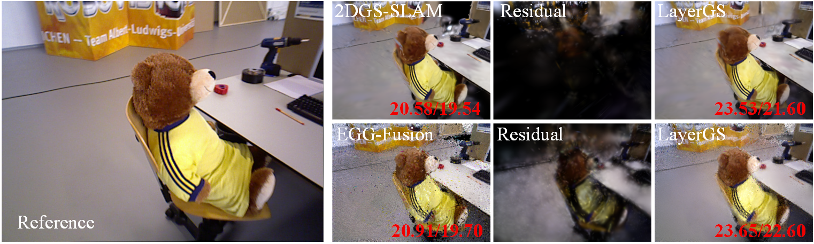

# LayerGS: Layered 2D–3D Gaussian Mapping for Dense RGB-D SLAM

LayerGS couples a 2D Gaussian surfel base with a lightweight residual 3D Gaussian layer to improve rendering quality in streaming RGB-D SLAM.

**Rendering and evaluation tools are available. Full implementation coming soon.**



## Samples

Partial reconstruction results from the EGG-Fusion integration:

Each package includes all exported keyframe renderings (base, residual-only, and LayerGS) under `renders/`, without evaluation scores.

| Dataset | Scene | Download |
| --- | --- | --- |
| Replica | room0 | [Model](https://github.com/WincentLi/layergs/releases/download/reconstruction-samples-20261021/replica_room0_layergs_eggfusion_sample.zip) |
| Replica | office0 | [Model](https://github.com/WincentLi/layergs/releases/download/reconstruction-samples-20261021/replica_office0_layergs_eggfusion_sample.zip) |
| TUM RGB-D | fr3_office | [Model](https://github.com/WincentLi/layergs/releases/download/reconstruction-samples-20261021/tum_fr3_office_layergs_eggfusion_sample.zip) |

## Complete Replica Run

[One complete run (round05)](https://github.com/WincentLi/layergs/releases/tag/replica-round05-20261027) across all eight scenes, with models, configurations, trajectories, and keyframe cameras. No rendered images or evaluation results are included. Earlier samples remain unchanged.

| Scene | Download |
| --- | --- |
| room0 | [Model](https://github.com/WincentLi/layergs/releases/download/replica-round05-20261027/replica_room0_layergs_eggfusion_round05.zip) |
| room1 | [Model](https://github.com/WincentLi/layergs/releases/download/replica-round05-20261027/replica_room1_layergs_eggfusion_round05.zip) |
| room2 | [Model](https://github.com/WincentLi/layergs/releases/download/replica-round05-20261027/replica_room2_layergs_eggfusion_round05.zip) |
| office0 | [Model](https://github.com/WincentLi/layergs/releases/download/replica-round05-20261027/replica_office0_layergs_eggfusion_round05.zip) |
| office1 | [Model](https://github.com/WincentLi/layergs/releases/download/replica-round05-20261027/replica_office1_layergs_eggfusion_round05.zip) |
| office2 | [Model](https://github.com/WincentLi/layergs/releases/download/replica-round05-20261027/replica_office2_layergs_eggfusion_round05.zip) |
| office3 | [Model](https://github.com/WincentLi/layergs/releases/download/replica-round05-20261027/replica_office3_layergs_eggfusion_round05.zip) |
| office4 | [Model](https://github.com/WincentLi/layergs/releases/download/replica-round05-20261027/replica_office4_layergs_eggfusion_round05.zip) |

## TUM RGB-D Run

[Fifth run (seed 2005)](https://github.com/WincentLi/layergs/releases/tag/tum-round05-20261028), with models, configurations, trajectories, and keyframe cameras. No rendered images or evaluation results are included.

| Sequence | Download |
| --- | --- |
| fr1_desk | [Model](https://github.com/WincentLi/layergs/releases/download/tum-round05-20261028/tum_fr1_desk_layergs_eggfusion_round05.zip) |
| fr2_xyz | [Model](https://github.com/WincentLi/layergs/releases/download/tum-round05-20261028/tum_fr2_xyz_layergs_eggfusion_round05.zip) |
| fr3_office | [Model](https://github.com/WincentLi/layergs/releases/download/tum-round05-20261028/tum_fr3_office_layergs_eggfusion_round05.zip) |

## Rendering and Evaluation

Requires Linux, an NVIDIA GPU, CUDA, and compatible PyTorch/torchvision.

```bash
pip install -r requirements-render.txt
pip install --no-build-isolation ./rasterizers/diff-gaussian-surfels ./rasterizers/diff-gaussian-rasterization
python render_eval.py --model-dir samples/room0 --output outputs/room0 --frame-ids 0
```

Extract a model package into `samples/room0` first. The script renders the base, residual-only, and fused images. Add `--gt-manifest /path/to/gt.csv` to evaluate PSNR, MS-SSIM, and LPIPS.

See [usage details](docs/rendering.md) for reference-data preparation and additional options.
